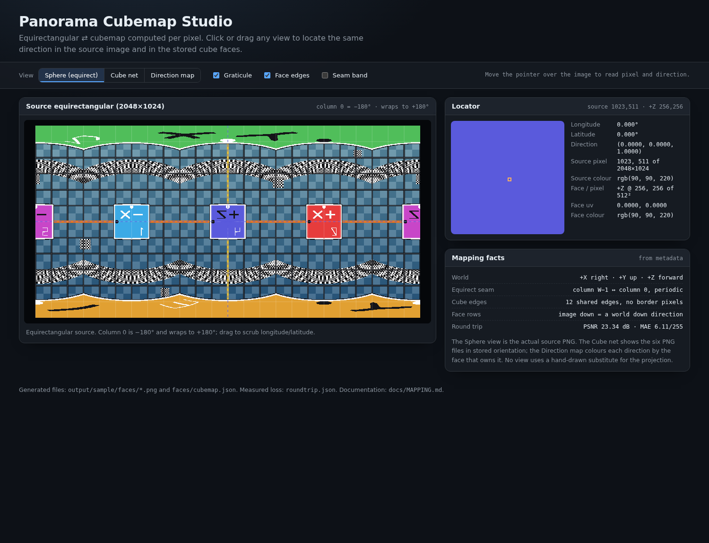

# Panorama Cubemap Studio

A dependency-free Node.js tool that converts an equirectangular panorama into
six real cube-face PNG files, reconstructs an equirectangular image from a
cubemap, and ships a browser viewer that locates the same direction in both.
The pixels are genuinely resampled by projection — no view-only shader tricks
and no hand-drawn placeholder faces.



## What it does

- **equirect → cube**: writes `px.png`, `nx.png`, `py.png`, `ny.png`,
  `pz.png`, `nz.png` plus `cubemap.json` describing every face axis, edge,
  pixel convention and filter setting.
- **cube → equirect**: reconstructs a panorama from those six files. This is
  a resampling step and is **explicitly lossy**; the loss is measured, not
  hidden.
- **Viewer**: switch between the source equirectangular image, the stored cube
  net, and a face-ownership direction map. Click any view to read longitude,
  latitude, direction, source pixel and owning face pixel.

## Quick start

```sh
npm run build:sample     # writes output/sample (chart, faces, metadata, metrics)
npm test                 # 47 geometry / filtering / seam / round-trip tests
npm run serve            # http://localhost:4173/web/
npm run verify:web       # headless-browser acceptance checks
```

Convert your own panorama:

```sh
node bin/cli.mjs equirect-to-cube my-pano.png my-cubemap --size 1024
node bin/cli.mjs cube-to-equirect my-cubemap my-pano-back.png --width 4096
```

## Conventions at a glance

World frame is right-handed: **+X right, +Y up, +Z forward**. Longitude
`theta = atan2(x, z)`, latitude `phi = asin(y)`. The equirect source uses
half-pixel centres, `theta = -pi + 2*pi*(px+0.5)/W`, with a periodic
horizontal seam (no black border). Each cube face is an outward-looking camera
with an explicit image-right and image-down world vector and
`det(right, down, centre) = +1`; stored pixels are texel centres. All 12 shared
edges are derived from geometry and traversed in opposite directions by their
two faces, so no neighbour is flipped or rotated against its neighbour.

Full contract, formulas, filtering and measured loss: **[docs/MAPPING.md](docs/MAPPING.md)**.

## Filtering

- equirect → cube integrates the exact projected footprint of each texel,
  decomposing it into latitude bands weighted by exact spherical solid angle
  and longitude intervals integrated periodically with prefix sums. Polar
  texels that cover all longitudes are ring-averaged. Small footprints fall
  back to bilinear reconstruction.
- cube → equirect supersamples each output pixel from the direction Jacobian
  and blends both faces within one texel of an edge, removing visible seams.

## Measured loss (not byte-lossless)

On the bundled 2048×1024 calibration chart (six 512² faces, round trip back to
2048×1024) the PSNR is **≈23.3 dB** and MAE **≈6.1/255**. The chart contains
near-Nyquist checker quads and hard graticule lines, so that number is low by
design and demonstrates that the pipeline really touches pixels. On a smooth
analytic field the same pipeline gives >45 dB and <0.5/255 MAE. Both sets of
metrics are written to `faces/cubemap.json` and `roundtrip.json`; the tests
assert the loss is non-zero and that the recorded numbers match a fresh
measurement.

## Layout

```
src/geometry.js   world/equirect/face math, pixel centres, derived edge table
src/resample.js   area and supersampled resampling, seam blending, metrics
src/chart.js      calibration chart and analytic ground truth
src/png.js        dependency-free PNG encode/decode
src/net.js        foldable cube net derived from the edge table
src/manifest.js   cubemap.json writer/reader
bin/cli.mjs       conversion and sample-build commands
bin/serve.mjs     static server for the viewer
web/              viewer (sphere / cube net / direction map)
test/             test harness and suites
scripts/          headless-browser acceptance checks
docs/MAPPING.md   mapping specification
output/sample/    generated chart, six faces, metadata, metrics
```
