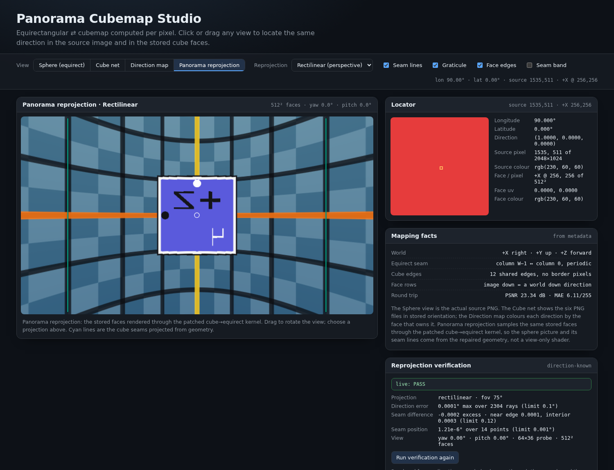

# Panorama Cubemap Studio

A dependency-free Node.js tool that converts an equirectangular panorama into
six real cube-face PNG files, reconstructs an equirectangular image from a
cubemap, and ships a browser viewer that locates the same direction in both.
The pixels are genuinely resampled by projection — no view-only shader tricks
and no hand-drawn placeholder faces.



## What it does

- **equirect → cube**: writes `px.png`, `nx.png`, `py.png`, `ny.png`,
  `pz.png`, `nz.png` plus `cubemap.json` describing every face axis, edge,
  pixel convention and filter setting.
- **cube → equirect**: reconstructs a panorama from those six files. This is
  a resampling step and is **explicitly lossy**; the loss is measured, not
  hidden.
- **Viewer**: switch between the source equirectangular image, the stored cube
  net, a face-ownership direction map, and a **panorama reprojection** view
  that renders the stored faces through the same kernel `cube → equirect`
  uses. Click any view to read longitude, latitude, direction, source pixel
  and owning face pixel.

## Panorama reprojection

`src/reproject.js` is a shared, dependency-free kernel (Node and browser)
that renders the cubemap under a selectable camera:

- **Rectilinear** — pinhole camera; drag to rotate yaw/pitch, `fov` sets zoom.
- **Equirectangular** — full 360×180 panorama; drag shifts longitude/latitude.

Every output pixel becomes a unit direction and is sampled with
`sampleCubeDirection` from `src/resample.js` — the repaired cross-face
bilinear sampler. The UI therefore cannot show a picture that disagrees with
the tested geometry. Cube seam lines are not drawn by hand: they are the 12
edges from the geometry table, projected through the same camera model, and
the dashboard reports the measured round-trip error of those positions.

The verification panel is driven by the kernel. Entering the view, dragging
the camera, or changing the projection re-runs `measureReprojection` and
renders the absolute pass/fail. The metrics are direction error (a
direction-encoded cubemap decoded back through the camera), seam difference
(worst error within 1.5 texels of a cube edge minus the interior error), and
seam position round-trip. Limits are absolute and tight enough to fail the
pre-fix kernel; a non-finite or missing measurement is shown as **FAIL**, never
substituted with a default.

### Start the UI

```sh
npm run serve
# open http://localhost:4173/web/  (static server, no build step)
```

Then click **Panorama reprojection**, drag to rotate, and use the
**Reprojection** select to switch rectilinear/equirectangular. The
**Reprojection verification** panel updates from the kernel. To check it
headlessly instead:

```sh
npm run verify:reproject   # writes output/sample/reprojection-verify.json
npm run verify:web         # Playwright: rotates the view, switches projection,
                           # asserts the pixels and seams come from the kernel
```


## Quick start

```sh
npm run build:sample     # writes output/sample (chart, faces, metadata, metrics)
npm test                 # 69 geometry / filtering / seam / boundary / reprojection tests
npm run serve            # http://localhost:4173/web/
npm run verify:web       # headless-browser acceptance checks (installs browser on first use)
```

Convert your own panorama:

```sh
node bin/cli.mjs equirect-to-cube my-pano.png my-cubemap --size 1024
node bin/cli.mjs cube-to-equirect my-cubemap my-pano-back.png --width 4096
```

## Conventions at a glance

World frame is right-handed: **+X right, +Y up, +Z forward**. Longitude
`theta = atan2(x, z)`, latitude `phi = asin(y)`. The equirect source uses
half-pixel centres, `theta = -pi + 2*pi*(px+0.5)/W`, with a periodic
horizontal seam (no black border). Each cube face is an outward-looking camera
with an explicit image-right and image-down world vector and
`det(right, down, centre) = +1`; stored pixels are texel centres. All 12 shared
edges are derived from geometry and traversed in opposite directions by their
two faces, so no neighbour is flipped or rotated against its neighbour.

Full contract, formulas, filtering and measured loss: **[docs/MAPPING.md](docs/MAPPING.md)**.

## Filtering

- equirect → cube integrates the exact projected footprint of each texel,
  decomposing it into latitude bands weighted by exact spherical solid angle
  and longitude intervals integrated periodically with prefix sums. Polar
  texels that cover all longitudes are ring-averaged. Small footprints fall
  back to bilinear reconstruction.
- cube → equirect supersamples each output pixel from the direction Jacobian
  and samples through an **extension-grid bilinear** stencil: taps that fall
  outside a face are re-projected onto the neighbouring face, so the two
  faces are blended by construction instead of masking the seam with a
  copied edge pixel.

### Boundary regressions

Three real defects were reduced to minimal, direction-known reproductions and
are now pinned by `test/boundary.test.mjs` (11 tests; three of them fail on
the pre-fix kernel):

1. **Even-`N` pole corner** — the pole-direction texel corner had a
   degenerate longitude (`atan2(0,0)=0`), so per-vertex wrap folded a
   quarter-ring wedge into a 90–180° span. Footprint polygons are now
   unwrapped against the neighbouring non-polar vertices.
2. **Polar-cap rows** — the sampled footprint started one latitude ring
   inside the texel, dropping polar-cap rows including the pole row. The
   footprint now extends to the pole for the `±Y` faces.
3. **Cross-face step** — the old sampler only blended on the exact edge,
   leaving a hard one-sided step (analytic max error 0.692 levels). The
   extension-grid sampler reduced it to 0.071 without changing the seam
   profile.

The tests assert the repaired behaviour with absolute thresholds, not
defaults: a missing or non-finite value fails rather than passing.
`npm run evidence:boundary` re-runs the direction-known probes against the
pre-fix snapshot in `test/fixtures/prefix-kernel` and the repaired kernel, and
writes `output/sample/boundary-evidence.json`:

| probe | pre-fix | repaired |
| ----- | ------- | -------- |
| even-N pole quadrant leakage | 1.2 levels | 0 |
| odd-N polar-cap centre texel (rows 0–7 lit) | 0.00 | 22.31 |
| cross-face analytic max error | 0.692 | 0.071 |
| smooth round-trip max error | 0.399 | 0.162 |

`output/sample/reprojection-prefix-failure.json` keeps the pre-fix panorama
verification: all six runs fail the absolute limits (direction error up to
0.29°, seam excess ≈0.31), while the repaired kernel passes all six.

## Measured loss (not byte-lossless)

On the bundled 2048×1024 calibration chart (six 512² faces, round trip back to
2048×1024) the PSNR is **≈23.3 dB** and MAE **≈6.1/255**. The chart contains
near-Nyquist checker quads and hard graticule lines, so that number is low by
design and demonstrates that the pipeline really touches pixels. On a smooth
analytic field the same pipeline gives >45 dB and <0.5/255 MAE. Both sets of
metrics are written to `faces/cubemap.json` and `roundtrip.json`; the tests
assert the loss is non-zero and that the recorded numbers match a fresh
measurement.

## Layout

```
src/geometry.js   world/equirect/face math, pixel centres, derived edge table
src/resample.js   area and supersampled resampling, seam blending, metrics
src/reproject.js  panorama camera + direction/seam verification kernel
src/chart.js      calibration chart and analytic ground truth
src/png.js        dependency-free PNG encode/decode
src/net.js        foldable cube net derived from the edge table
src/manifest.js   cubemap.json writer/reader
bin/cli.mjs       conversion, sample-build and verify-reproject commands
bin/serve.mjs     static server for the viewer
web/              viewer (sphere / cube net / direction map / panorama)
test/             test harness and suites (incl. boundary regressions)
test/fixtures/    pre-fix kernel snapshot used only for before/after evidence
scripts/          headless-browser acceptance checks, boundary evidence
docs/MAPPING.md   mapping specification
output/sample/    generated chart, six faces, metadata, metrics, verification
```
